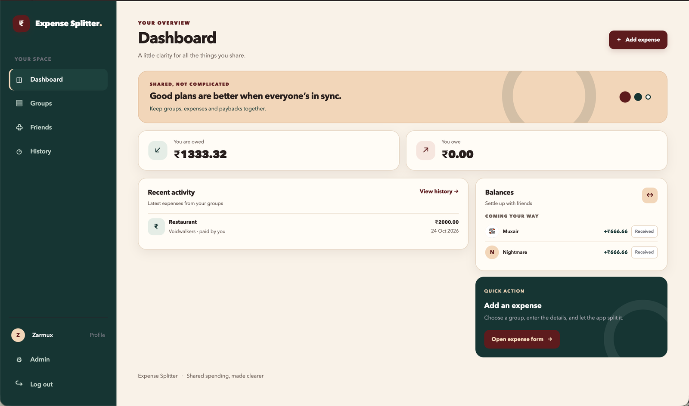
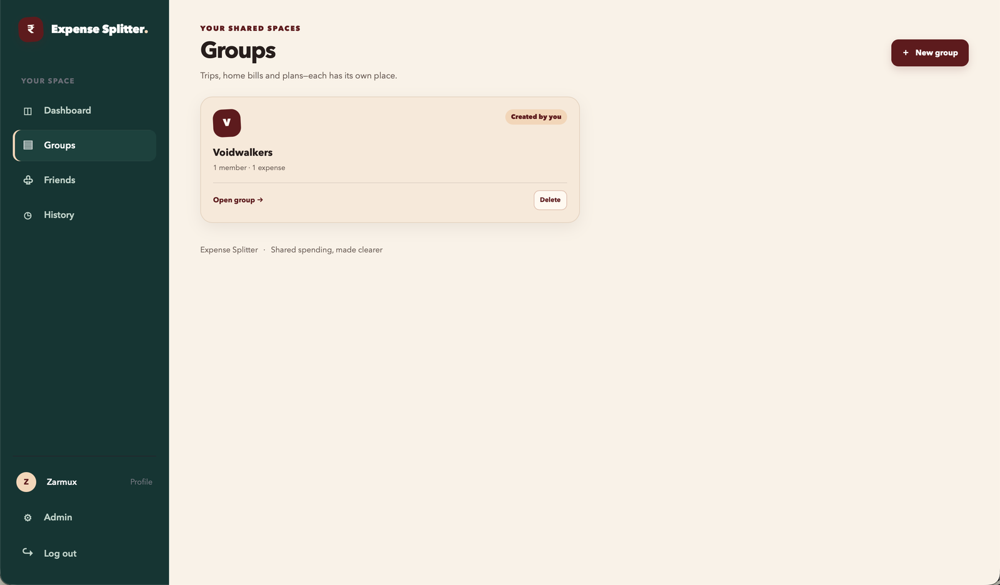
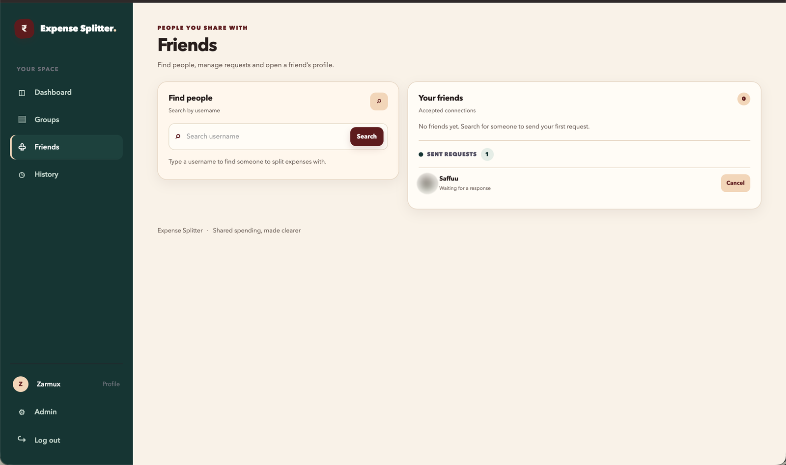
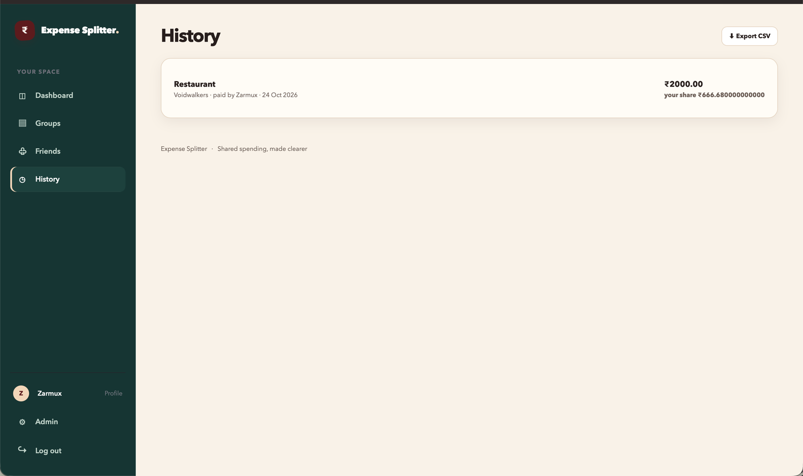
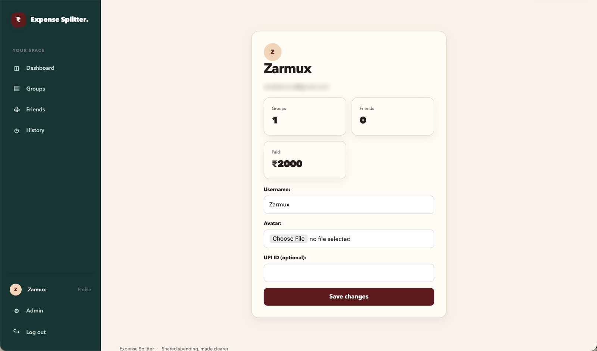

<div align="center">

# ₹ Expense Splitter

### Shared spending, made clearer.

Split bills with friends, see exactly who owes whom, and settle up in a couple of taps, with UPI built in.


<br>



</div>

---

## 📖 Table of contents

- [The problem](#-the-problem)
- [The solution](#-the-solution)
- [Features](#-features)
- [Screenshots](#-screenshots)
- [How it works](#-how-it-works)
- [Tech stack](#-tech-stack)
- [Getting started](#-getting-started)
- [Running the tests](#-running-the-tests)
- [Project structure](#-project-structure)
- [Roadmap](#-roadmap)
- [Author](#-author)

---

## 😩 The problem

Anyone who has shared a trip, a flat or a dinner knows how it goes:

- 💬 **Who paid for what?** The answer is buried somewhere in a 400-message group chat.
- 🧮 **Nobody can do the maths.** ₹2,000 split three ways leaves a leftover paisa, and then a quiet argument about it.
- 🔁 **Money goes round in circles.** You owe Sam, Sam owes Kim, Kim owes you, and nobody knows the real balance.
- 😬 **Asking for money is awkward**, and paying back means typing UPI IDs and amounts by hand.

Spreadsheets get out of date, and memory is a bad accountant.

## 💡 The solution

**Expense Splitter** keeps one shared record for every group. Add an expense once and it is split fairly and exactly. The app then tells everyone what they are owed, what they owe and who to pay, and it opens your UPI app with the payee and amount already filled in.

> No more "I'll pay you later", no more spreadsheets, and no more guessing.

---

## ✨ Features

| | Feature | What it does |
|---|---|---|
| 📊 | **Live dashboard** | See *You are owed* and *You owe* at a glance, with your latest activity beneath. |
| 👥 | **Groups** | Create a group for every trip, home or plan, from your friends only. |
| ➗ | **Exact equal splits** | Every expense is divided to the paisa, and the extra paise are handed out so the shares **always add up to the total**. |
| 🤝 | **Friends** | Search people by username, send and cancel requests, accept invites and manage your friend list. |
| ⚖️ | **Net balances** | Debts across *all* your groups are combined per person, so you see one clear number for each friend. |
| 📲 | **Pay with UPI** | Tap **Pay** to open your UPI app (GPay, PhonePe, Paytm...) with the payee, name, amount and ₹ currency pre-filled. |
| ✅ | **One-tap settle up** | Mark a balance as **Paid** or **Received** and both sides update straight away. |
| 🕘 | **History + CSV export** | Browse every expense with your share, then download it all as a spreadsheet. |
| 🙋 | **Profile & onboarding** | Pick a username, add an avatar and a UPI ID, and see your stats (groups, friends, total paid). |
| 🔐 | **Private by default** | Every page needs a login, and only group members can open a group. |
| 🛠️ | **Admin panel** | Manage users, groups and expenses through Django admin. |

---

## 🖼️ Screenshots

### Dashboard
Your money at a glance: what you're owed, what you owe, recent activity, and one-tap settle-up buttons.


### Groups
Every trip, flat or plan gets its own space.



### Friends
Find people by username, manage pending requests and keep your friend list tidy.



<table>
  <tr>
    <td width="50%" valign="top">
      <b>History</b> - every expense, your share and a CSV export<br><br>
      
    </td>
    <td width="50%" valign="top">
      <b>Profile</b> - username, avatar, UPI ID and your stats<br><br>
      
    </td>
  </tr>
</table>

---

## 🔄 How it works

1. **Sign up** with email and choose a username and an optional UPI ID.
2. **Add friends** by searching their username.
3. **Create a group** from your friends, for example *Goa Trip* or *Flat 4B*.
4. **Add an expense**: say what it was, how much, and who paid. It is split equally and exactly.
5. **Check your dashboard** to see your net balance with each person across all groups.
6. **Settle up**: tap **Pay** to open your UPI app, then mark it **Paid** (or **Received** if you're the one being paid).

### 🧠 A closer look at the split

Money is stored as exact decimals, not floating-point numbers, so there are no rounding surprises. When an amount doesn't divide evenly, the leftover paise are shared out one by one:

```text
₹100.00 split between 3 people  →  ₹33.34  +  ₹33.33  +  ₹33.33  =  ₹100.00 ✓
```

---

## 🧰 Tech stack

| Layer | Technology |
|---|---|
| Language | Python |
| Framework | Django |
| Authentication | django-allauth (email sign-up and login, social providers supported) |
| Images | Pillow (profile avatars) |
| Frontend | Django templates + hand-written CSS (no JavaScript framework) |
| Payments | UPI deep links (`upi://pay`) |
| Testing | Django `TestCase` |

---

## 🚀 Getting started

### Prerequisites
- A recent version of Python 3
- `pip` and `venv`

### Installation

```bash
# 1. Clone the repository
git clone https://github.com/YOUR-USERNAME/YOUR-REPO.git
cd YOUR-REPO

# 2. Create and activate a virtual environment
python -m venv venv
source venv/bin/activate        # Windows: venv\Scripts\activate

# 3. Install dependencies
pip install -r requirements.txt
# or: pip install django django-allauth pillow

# 4. Create the database tables
python manage.py migrate

# 5. Create an admin account
python manage.py createsuperuser

# 6. Start the app
python manage.py runserver
```

Open **http://127.0.0.1:8000** and sign up.

> 💡 **Trying it on your own?** Sign up with two different accounts (use a private window for the second one), finish the profile step on both, then add each other as friends. That's the quickest way to see balances and settle-ups in action.

---

## ✅ Running the tests

```bash
python manage.py test expenses
```

The tests cover the dashboard, expense and balance data, settle-up payments, logout and the main authenticated pages.

---

## 🗂️ Project structure

```text
expenses/
├── models.py        # Group, Expense, Split, Friendship, Profile, Payment
├── services.py      # Equal-split maths and the cross-group balance overview
├── views.py         # Dashboard, groups, friends, history (CSV), profile, settle
├── forms.py         # Expense, group and onboarding forms
├── middleware.py    # Sends new users through profile setup first
├── urls.py          # Routes
├── admin.py         # Django admin registration
├── tests.py         # Automated tests
└── templates/expenses/   # Pages and reusable pieces
```

---


## 🗺️ Roadmap

Ideas for where it could go next:

- [ ] Unequal splits: by exact amount, percentage or shares
- [ ] "Simplify debts": the fewest payments needed to settle a whole group
- [ ] Payee confirmation, so a payment only counts once the other person confirms it
- [ ] Edit and delete expenses
- [ ] Recurring expenses (rent, subscriptions)
- [ ] Receipt photos and spending charts
- [ ] Activity feed and payment reminders

---

## 👤 Author

**Your Name**
GitHub: [@YOUR-USERNAME](https://github.com/YOUR-USERNAME)

If this project helped you, consider giving it a ⭐

